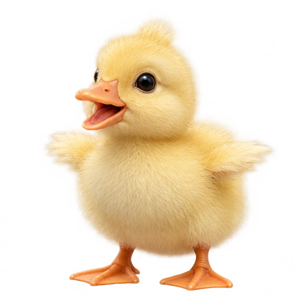
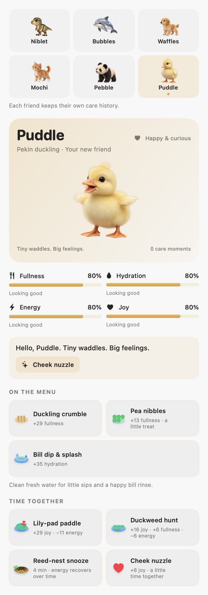
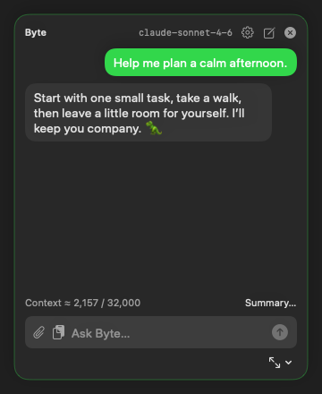
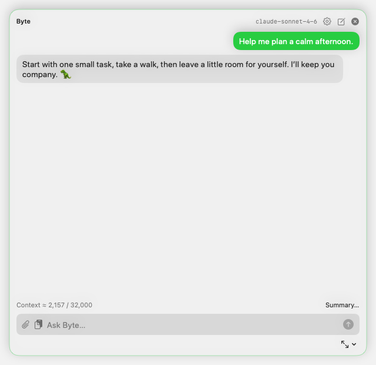
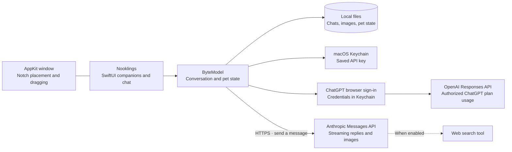

<div align="center">


<h1>Nooklings</h1>

**Little friends. A cozier Mac.**

Six lifelike baby animals with animated care, their own daily routines, and optional Claude or ChatGPT chat.

<br>


<br><br>

[Meet the Nooklings](#meet-the-nooklings) · [Features](#features) · [Get started](#get-started) · [Settings](#settings) · [Privacy & cost](#privacy-and-cost) · [Troubleshooting](#troubleshooting) · [Development](#development)

</div>

---

Nooklings gives your Mac a little companion to care for. Meet **Niblet** the T-Rex hatchling, **Bubbles** the dolphin calf, **Waffles** the golden retriever puppy, **Mochi** the tabby kitten, **Pebble** the panda cub, and **Puddle** the duckling. Each baby has lifelike expressions, favorite foods, playful activities, and a cozy way to curl up for a nap. Their needs, age, and care history are saved separately.

They live just below your Mac’s notch, or wherever you drag them. When you want help with a question, an image, or web research, open the optional Claude or ChatGPT panel. Nooklings also works on Macs without a notch.

Click to chat, or press **⌃⌥Space** from any app. Hover to care. Drag to make yourself at home.

**Pet care works offline, without an AI account or credits.** For replies, use an eligible ChatGPT plan through browser sign-in, or connect your own Anthropic API key. Credentials stay in macOS Keychain. Nooklings is built with SwiftUI and AppKit, with no third-party runtime dependencies.

> **Source preview:** Nooklings is currently built from source. Ordinary builds are unsigned; a [signing and notarization workflow](docs/DISTRIBUTION.md) is ready for Apple credentials. Native checks cover the new controls and recovery paths. Real sign-in, signed upgrades, and VoiceOver still need an installed-app pass. See the [review and validation notes](docs/CODE_REVIEW.md) for evidence.

<a id="meet-byte"></a>
<a id="meet-the-nooklings"></a>

## Meet the Nooklings

<table>
<tr>
<td align="center" width="33%"><br><strong>Niblet</strong><br>T-Rex hatchling<br><em>Tiny teeth. Giant cuddles.</em></td>
<td align="center" width="33%"><br><strong>Bubbles</strong><br>Dolphin calf<br><em>Little flippers. Big wonder.</em></td>
<td align="center" width="33%"><br><strong>Waffles</strong><br>Golden retriever puppy<br><em>Little paws. Whole-heart wags.</em></td>
</tr>
<tr>
<td align="center" width="33%"><br><strong>Mochi</strong><br>Tabby kitten<br><em>Pocket-sized purrs.</em></td>
<td align="center" width="33%"><br><strong>Pebble</strong><br>Giant panda cub<br><em>A little fluff. A lot of hugs.</em></td>
<td align="center" width="33%"><br><strong>Puddle</strong><br>Pekin duckling<br><em>Tiny waddles. Big feelings.</em></td>
</tr>
</table>

Choose a friend from **Care**, available on the hover bar or right-click menu. See the [companion guide](docs/COMPANIONS.md) for their care routines. Your current companion stays selected on upgrade, and your original `pet.json` stays intact. Each friend’s needs continue to advance with elapsed time when you return to them.

Already caring for a Nookling? Byte is now **Niblet**, Ripple is **Bubbles**, Biscuit is **Waffles**, Miso is **Mochi**, and Bao is **Pebble**. Their new baby faces and names carry forward the same needs, age, nap progress, and care history. Puddle keeps the name and duckling look you know.

| Companion | Food & treat | Hydration / refresh | Play & gentle activity | Rest |
| --- | --- | --- | --- | --- |
| **Niblet · hatchling** | Hatchling bites · turkey morsels | Watering hole | Stomp chase · scent trail | 5-minute nest nap |
| **Bubbles · calf** | Little fish bites · squid snack | Splash refresh for skin freshness; fish also restores moisture | Hoop dive · bubble chase | 4-minute quiet drift |
| **Waffles · puppy** | Puppy supper · crunchy biscuit | Refilled water bowl | Fetch · sniff safari | 5-minute cozy nap |
| **Mochi · kitten** | Kitten salmon · chicken nibbles | Fresh drinking fountain | Feather pounce · sunbeam chase | 3-minute catnap |
| **Pebble · cub** | Tender bamboo · apple slices | Forest spring | Bamboo roll · leaf puzzle | 6-minute bamboo snooze |
| **Puddle · duckling** | Duckling crumble · pea nibbles | Fresh-water bill dip & splash | Lily-pad paddle · duckweed hunt | 4-minute reed-nest snooze |

Puddle brings happy waddles, little bill dips, quiet peeps, and a tucked-in sleeping pose. Duckweed hunts restore a little fullness as well as joy, and the cozy reed nest stays visible through the snooze.

Food and water replenish needs up to 100%; play uses energy. Hungry, thirsty, or exhausted friends ask for care before energetic games. Rest recovers energy over time, including while the app is closed; **Wake gently** keeps only the energy already recovered. These are playful virtual-pet routines. Care works locally and never requires AI credits.

<p align="center">


</p>

*Native macOS renders of the full care content. The app presents this inside a compact scrolling panel.*

The quick controls and dashboard run the same animations and award care once at the action’s payoff. Switching companions is paused during care or a streaming reply. The chat persona changes with your friend; the conversation and AI connection stay shared across the app.

<a id="features"></a>

## ✨ What you get

### 🐾 A little routine with your companion

- **Six lifelike baby companions** with neutral, happy, thinking, eating, drinking, and sleeping expressions. Each animal brings its own care movements, quiet sound cues, and friendly reactions.
- **A modern care dashboard** with fullness, hydration (freshness for Bubbles), energy, joy, suggested actions, and recent moments. Each companion keeps separate needs, age, care history, and rest progress.
- **Species-specific care** with two foods, two play activities, water or splash refreshes, affection, and timed naps. Smooth props and quiet synthesized cues replace the pixel objects. Reduce Motion keeps care functional with static expressions.
- **Optional check-ins** and adjustable puns, from off to lots.
- **A home under the notch**, or wherever you drag them. Their pinned position is remembered; a right-click resets it.

### 🧠 Claude or ChatGPT, one click away

- **Continue with ChatGPT** uses OpenAI's documented sign-in flow for local apps. Eligible Plus and Pro users can authorize plan usage without an API key.
- **Account and model choices** keep ChatGPT registrations separate and load the selected account's available models.
- **Claude API access** remains available with an Anthropic key; subscription login requires prior Anthropic approval for a third-party product.

- **Streaming replies** in a compact panel, with Markdown formatting and copyable code blocks.
- **Image questions** using the file picker, drag and drop, or paste. Images are resized off the UI thread; missing attachments have Locate/Remove recovery controls. Attach a screenshot, diagram, or photo to your next message.
- **Optional web search** with source links. Claude searches are capped at three by default and configurable; ChatGPT follows your model and account policy.
- **Live model discovery** checks Claude availability and capabilities with your key. Shared metadata drives requests and dated pricing; unknown or stale prices are labeled.
- **Stop reply** to cancel generation or a retry. Partial text stays visible with an interruption status.
- **Context and spending controls** show a conservative thread estimate, offer an editable summary, and expose Claude output/search caps and an optional daily API spending guard.

### 📚 Conversations you can come back to

- **Persistent chat history** and locally stored image attachments.
- **New chat** archives your current thread before clearing it.
- **Saved chats** lets you browse, reopen, or delete an archive. Safe cleanup only removes images unreferenced by live, archive, and recovery records; a damaged record stops cleanup.
- **Prompt saving and streaming checkpoints** preserve work before a request and about once a second while replies arrive.
- **Visible storage errors**: failed archiving keeps the live conversation available, and unreadable history is preserved in a recovery copy before replacement.

### 🍎 Built for the Mac

- **SwiftUI + AppKit**, with a transparent, borderless companion window and no Dock icon.
- **macOS Keychain** for API keys entered in the app.
- **Launch at login** for an installed app bundle.
- **Configurable global shortcut** opens and focuses chat across apps; it never captures your screen or clipboard.
- **Resizable chat** remembers its size, keeps the panel on a real display, and lets you read older replies while streaming.
- **No notch required**: Nooklings falls back to the top of the main display.

<p align="center">


</p>

*Native macOS chat renders at compact and expanded sizes. The panel remembers your preferred size.*

<a id="get-started"></a>
## 🚀 Get started

### 1. Check your Mac

| Requirement | Details |
| --- | --- |
| Operating system | **macOS 14 Sonoma or newer** |
| Build tools | **Swift 5.9+**, supplied by Xcode or Xcode Command Line Tools |
| AI chat | An **eligible ChatGPT plan** or **Anthropic API key**, and an internet connection |
| Pet and care | Works locally without an API key |

Check your toolchain with `swift --version`. If Apple's command-line tools are missing, run `xcode-select --install` and finish the installer before continuing.

### 2. Clone and run

The app and repository are **Nooklings**. Existing Byte data and connections are preserved.

```bash
git clone https://github.com/ronniekai999/nooklings.git nooklings
cd nooklings
swift run Nooklings
```

Your companion appears near the top of your display. **Click to open chat, or hover and choose Care to meet all six.** Choose **ChatGPT · your plan** and **Continue with ChatGPT**, then approve Nooklings in your browser. Nooklings loads your account's available models after connecting. You can also use the pet first, or choose **Claude · API key**, paste your key, and choose **Save**.

ChatGPT requests use your authorized plan allowance or available credits. **Manage usage** opens ChatGPT settings, where you can review usage and set Nooklings’ limits. This uses the supported local-app integration, not a Codex login or access to existing ChatGPT conversations. Paid or remotely hosted distribution needs OpenAI approval; see [OpenAI's plan-usage guide](https://developers.openai.com/siwc/token-sharing-open-source).

For Claude, create a key in the [Anthropic Console](https://console.anthropic.com/). API requests use your API billing or eligible credits. Anthropic's October 7, 2026 update adds monthly API credits to Max and Team plans, but its developer docs still require prior approval to offer subscription login in a third-party product. See [the subscription update](https://support.claude.com/en/articles/15036540-use-the-claude-agent-sdk-with-your-claude-plan) and [the developer requirement](https://code.claude.com/docs/en/agent-sdk/overview#get-started). Being a general companion app does not change that requirement.

### 3. Make it an app

From the repository directory:

```bash
./bundle.sh
open Nooklings.app
```

The script builds the release executable and assembles `Nooklings.app` with its icon, all companion artwork, and macOS bundle metadata. Move the app into **Applications** for everyday use, then enable **Launch at login** in Nooklings’ Settings if desired.

This is a locally built, **unsigned** bundle. If macOS asks for confirmation, use Finder's **Open** action and follow the system prompts. For distribution, follow the prepared [Developer ID signing and notarization workflow](docs/DISTRIBUTION.md). Apple credentials and an installed-app upgrade check are still needed.

<details>
<summary><strong>Use an environment variable instead of saving a key</strong></summary>

An `ANTHROPIC_API_KEY` environment variable takes precedence over the key saved in Keychain. For a terminal-launched development session, enter it without putting the key in shell history:

```bash
read -r -s -p "Anthropic API key: " ANTHROPIC_API_KEY
printf '\n'
export ANTHROPIC_API_KEY
swift run Nooklings
unset ANTHROPIC_API_KEY
```

These commands use **Bash**; run `bash` first if your terminal uses another shell. A Finder-launched app does not automatically inherit this terminal variable. Use the in-app key form for an installed app.

</details>

### 4. Spend a little time together

| Action | What happens |
| --- | --- |
| **Click your companion** | Open or close chat |
| **Hover over your companion** | Reveal quick feed, water/splash, play, rest/wake, and Care controls |
| **Open Care** | Choose a companion; see needs, food choices, activities, rest progress, and recent care |
| **Drag your companion** | Move them and remember the new position |
| **Type, then Return** | Send a question |
| **Drop or paste an image** | Attach it to the next question |
| **Stop reply** | Cancel an active reply or retry |
| **New chat** | Archive the current thread and start fresh |
| **Saved chats** | Browse, reopen, or delete archived conversations |
| **Right-click your companion** | Open chat, perform tricks, manage care, reset position, sign out, or quit |

A few things to try:

- “Explain the error in this screenshot.” Paste an image, then ask.
- “Find the official documentation for this API.” Enable web search for source links.
- “Help me simplify this Swift function.” Paste code and copy the suggested result.
- Bring Pebble some tender bamboo, help Bubbles splash, or take Puddle on a duckweed hunt.

The companion window sits **below** the physical notch cutout. Dragging your companion lets you choose a different spot on your display.

<a id="settings"></a>
## ⚙️ Make Nooklings yours

Open chat and choose the **gear** in its header.

| Setting | Default | What it changes |
| --- | --- | --- |
| AI connection | Claude API for existing installations | Choose Claude API or your ChatGPT plan; manage saved connections |
| ChatGPT account | Last selected registration | Switch accounts/workspaces, add an account, reauthorize, or sign out |
| Web search | On | Allows the provider to search when the selected model/account supports it |
| Sound effects | On | Plays a quiet sound palette for each animal |
| Random check-ins | On | Lets your companion occasionally say hello or mention a need |
| Puns | Lots | Choose Off, Light, or Lots |
| Model | Sonnet 4.6 for Claude; first available catalog entry for ChatGPT | Selects the next request's model |
| Effort | High | Low, Medium, or High for supported Claude models; disabled for ChatGPT |
| Global chat shortcut | ⌃⌥Space | Record a combination with Command or Control, or disable it |
| Thread context | 32,000 estimated tokens | Pauses oversized sends while keeping the draft; use New chat or Summary… |
| Claude output cap | 2,048 tokens | Configurable reply limit, subject to model support |
| Claude search cap | 3 per reply | Choose 0–10; zero disables search |
| Daily API guard | Off ($0) | Local estimate in USD; persists across restarts, resets at UTC midnight |
| Launch at login | Reflects macOS registration | Starts an installed Nooklings bundle when you sign in |

### Model choices

ChatGPT choices come from your account's live model catalog, preserving its ordering. Use **Refresh models** to retry a failed catalog request. Capabilities such as image input and web search depend on the chosen model and account policy; provider errors remain visible and do not silently switch billing.

Claude's **Check availability** loads your key's current catalog, including capabilities and input/output limits. Retired models are excluded; unavailable saved choices pause sending until you choose another model. New models are not assigned guessed prices or optional features. Settings shows the availability check time and the pricing verification date.

See [Models and limits](docs/MODELS_AND_LIMITS.md) for reference prices, supported controls, and provider restrictions. ChatGPT's plan route does not accept output or search-call caps; use **Manage usage** for plan and credit controls.

<a id="privacy-and-cost"></a>
## 🔐 Your data, connections, and usage

### Upgrading from Byte

Quit the old Byte app before opening **Nooklings.app**, then replace the old app in Applications. If you use Launch at login, turn it off in Byte before replacing the app and turn it on again in Nooklings afterward.

Your original Byte pet, conversations, images, settings, pinned position, and saved connections remain available. To preserve them, Nooklings retains `~/.config/byte`, the `com.ronnie.byte` bundle identifier, existing preference keys, and Keychain service names. Source launches also migrate preferences from the old `Byte` and `Nooklings` process domains into the same stable suite without overwriting existing values. Existing ChatGPT registrations may still appear as **Byte** in your account; new registrations use **Nooklings**. Internal Swift module and source paths also retain `Byte` for compatibility.

### What stays on your Mac

Nooklings stores conversations, pet state, and attachments under `~/.config/byte`:

```text
~/.config/byte/
├── history.json                 # Current conversation
├── pet.json                     # Niblet’s needs and history, preserved from Byte
├── pet-{animal}.json            # Separate dolphin, dog, cat, panda, and duck state
├── archives/
│   └── chat-<timestamp>-<UUID>.json
├── images/
│   └── <UUID>.jpg               # Resized image attachments
└── history-recovery-<UUID>.json  # Created when unreadable history is preserved
```

Settings, selected account, a stable opaque ChatGPT host ID, and pinned position use macOS preferences. API keys and ChatGPT account credentials use separate **Keychain** records, apart from conversation files. Chat and image files are local files; they are **not encrypted by Nooklings**. Back up the whole data directory to retain attachments alongside chats.

ChatGPT sign-in opens the system browser and briefly listens on `127.0.0.1` for its callback. Nooklings verifies the signed identity token, state, nonce, audience, issuer, and expiration before making the new account active. Returning sign-ins reuse that account's issued client ID and the installation's host ID. Tokens refresh automatically and are saved together in Keychain. Credential updates are coordinated across Nooklings processes. If Keychain rejects a save, Nooklings retains the replacement in memory and pauses plan requests until **Retry Keychain save** succeeds. Sign-out attempts remote revocation and clears local tokens; if revocation cannot be confirmed, Nooklings tells you to disconnect it in ChatGPT settings. Account registration metadata is retained for later sign-in.

Older `~/.config/byte/api_key` files are migrated to Keychain. The plaintext file is removed only after the Keychain write and read succeed; a failed migration retains the original and shows an error. The older `~/.config/finn` directory is migrated when a Byte directory does not already exist.

### What goes to your AI provider

When you send a question, Nooklings sends the thread's conversation context, its instructions, and attached images to the selected provider: the **Anthropic Messages API** or **OpenAI Responses API**. Switching providers sends subsequent requests, including the existing thread context, to the newly selected provider. AI replies require cloud access. With web search enabled, the provider can use its supported search tool.

ChatGPT requests use `store: false` and `stream: true`, resend local context, and only count a reply as complete after `response.completed`. Subscription usage limits can apply across apps or specifically to Nooklings. A limit pauses sending until you review **Manage usage** and choose **Try again**. Nooklings never silently falls back to paid Anthropic API calls.

Image attachment is explicit: pick a file, drag, paste, or use the clipboard button. The global shortcut only opens and focuses chat. Nooklings does not automatically capture your screen.

### How the cost estimate works

Claude's meter uses reported input/output tokens, cache read/write tiers, and searches at dated list prices. Unknown or stale prices are labeled instead of assuming another model's rate. The optional **Daily API guard** considers tracked usage plus a reserve for the next reply and its searches. It persists across restarts and provider switches, and resets at UTC midnight. Actual billing can differ, especially after disconnects or search-result expansion; use provider account controls for an enforced billing limit. ChatGPT shows reported tokens and links to **Manage usage**, without inventing a dollar estimate.

Long conversations resend context and images. The visible context estimate pauses oversized sends without discarding a draft. **Summary…** gives you local excerpts to edit into a summary, then archives the original before starting a shorter thread. No summarization API call or extra AI charge is made. Output and search caps apply to Claude; see [Models and limits](docs/MODELS_AND_LIMITS.md).

Deleting an archive attempts safe image cleanup. **Clean up unused images** in Settings scans live, archived, and recovery conversations. Unreadable records stop deletion; unrelated files and linked image files are preserved. Missing attachments can be located or explicitly removed before sending again. New image imports are limited to 25 MB and 100 megapixels and downsampled to a 1,568-pixel long edge.

<a id="troubleshooting"></a>
## 🩺 Troubleshooting

| Symptom | What to check |
| --- | --- |
| **Build tools are missing** | Run `xcode-select --install`, complete installation, and confirm `swift --version` reports 5.9+. Build on macOS 14 or newer. |
| **Nooklings has no Dock icon** | This is an accessory app. Look near the top of the display; right-click your companion for **Quit Nooklings**. |
| **My companion is in the wrong place** | Right-click them and choose **Reset position to notch**, then drag them to your preferred spot. |
| **Chat asks for a key after I saved one** | Check the selected AI connection, storage error banner, and Keychain access. For terminal runs, check whether `ANTHROPIC_API_KEY` overrides the saved key. |
| **ChatGPT sign-in or models fail** | Check the visible connection error and selected account. Retry **Continue with ChatGPT** or **Refresh models** in Settings. Plan/account eligibility and provider availability still apply. |
| **ChatGPT credentials couldn't be saved** | Unlock Keychain or restore Nooklings’ access, then choose **Retry Keychain save** in the connection form. Keep Nooklings open so the pending replacement can be saved. |
| **ChatGPT reports a usage limit** | Open **Manage usage** to review plan and Nooklings limits, then choose **Try again** when usage is available. |
| **A model request is rejected** | Use **Check availability** in Settings and choose a returned model. Unknown optional capabilities stay disabled; account policy can still restrict requests. |
| **An image is unavailable** | Use **Locate image…** on the message, or explicitly **Remove attachment**. Sending pauses until the missing context is addressed. |
| **The shortcut does not open chat** | Open Settings, record a new combination, and check the registration error. System-reserved shortcuts may be intercepted by macOS. |
| **A reply stalls or is interrupted** | Use **Stop reply** and send again when connectivity recovers. Partial replies remain visible with a status and are excluded from future assistant context. |
| **New chat or reopening reports a save error** | Check available disk space and access to `~/.config/byte`. Keep the live thread and recovery files until the storage problem is resolved. |
| **Launch at login does not work** | Use an installed `Nooklings.app` rather than `swift run`. Check **System Settings → General → Login Items** for approval or add the app there manually. |
| **Keychain asks for access after a rebuild** | Unsigned rebuilds and the first move to a signed build can prompt. Future signed releases must retain the same bundle ID and Apple team; see DISTRIBUTION.md. |

For a bug report, include your macOS version, Swift version, steps to reproduce, and the visible error. Remove API keys and private chat content before sharing logs or screenshots. [Open an issue](https://github.com/ronniekai999/nooklings/issues).

<a id="architecture"></a>
## 🏗️ How it works



SwiftPM builds one native executable. AppKit manages the companion window; SwiftUI renders the pet, chat, settings, and archives. The model handles pet simulation, persistence, request snapshots, streamed responses, cancellation, retries, and usage accounting.

<a id="development"></a>
## 🛠️ Development

Run the native checks **on a Mac**:

```bash
swift build
swift test
./bundle.sh
plutil -lint Nooklings.app/Contents/Info.plist
```

The [macOS workflow](.github/workflows/ci.yml) runs native regression tests and builds a universal Intel/Apple silicon bundle. Tests cover preferences migration, companion saves and elapsed care, global focus and shortcut settings, display geometry, context/spending guards, catalogs and pricing, attachment cleanup/recovery, persistence, streaming, and ChatGPT authentication. Native render artifacts include all companions and compact/expanded chat. Network and credential tests use temporary files and stubs, with no live API charges.

See [review evidence](docs/CODE_REVIEW.md), the [desktop validation matrix](docs/ACCESSIBILITY.md), and the [distribution guide](docs/DISTRIBUTION.md). Real provider sign-in, VoiceOver, Keychain upgrade prompts, and Login Items need an installed-app pass; unsigned CI cannot establish notarized-release readiness.

### Source map

| File | Responsibility |
| --- | --- |
| [App.swift](Sources/Byte/App.swift) | App lifecycle, borderless window, placement, and dragging |
| [ByteModel.swift](Sources/Byte/ByteModel.swift) | Conversation state, persistence, archives, pet care, and streaming |
| [AppPreferences.swift](Sources/Byte/AppPreferences.swift) | Stable preferences and source-launch migration |
| [GlobalShortcut.swift](Sources/Byte/GlobalShortcut.swift) · [WindowPlacement.swift](Sources/Byte/WindowPlacement.swift) | Global registration, recorder, and display-safe geometry |
| [ModelCatalog.swift](Sources/Byte/ModelCatalog.swift) · [ChatLimits.swift](Sources/Byte/ChatLimits.swift) | Shared capabilities/prices, context estimates, and spending ledger |
| [Attachments.swift](Sources/Byte/Attachments.swift) · [AttachmentInput.swift](Sources/Byte/AttachmentInput.swift) | Background preparation, explicit inputs, and safe cleanup |
| [AnthropicRequest.swift](Sources/Byte/AnthropicRequest.swift) | Model-specific request options and cumulative usage |
| [APIKeyStore.swift](Sources/Byte/APIKeyStore.swift) | Keychain storage and the testable key-store interface |
| [ChatGPTAuth.swift](Sources/Byte/ChatGPTAuth.swift) | Browser authorization, verified identities, protected account records, token refresh and sign-out |
| [ChatGPTCredentialLock.swift](Sources/Byte/ChatGPTCredentialLock.swift) | Shared credential locking across Nooklings processes |
| [OAuthLoopbackListener.swift](Sources/Byte/OAuthLoopbackListener.swift) | Temporary local OAuth callback listener |
| [ChatGPTRequest.swift](Sources/Byte/ChatGPTRequest.swift) | Subscription request contract and Responses stream events |
| [ByteView.swift](Sources/Byte/ByteView.swift) | Pet interaction, chat, Markdown, settings, and archives |
| [ByteSprite.swift](Sources/Byte/ByteSprite.swift) · [Props.swift](Sources/Byte/Props.swift) | Cached lifelike expressions and smooth care objects |
| [Companion.swift](Sources/Byte/Companion.swift) · [PetCare.swift](Sources/Byte/PetCare.swift) | Species profiles and elapsed-time care simulation |
| [CareView.swift](Sources/Byte/CareView.swift) | Companion selection, needs, and care dashboard |
| [Quips.swift](Sources/Byte/Quips.swift) · [Sound.swift](Sources/Byte/Sound.swift) | Personality and synthesized audio |
| [WebLinks.swift](Sources/Byte/WebLinks.swift) | HTTP(S)-only generated link handling |

For contributions, keep changes focused, explain the user-visible behavior, and run the relevant macOS checks. Add regression coverage for changes to persistence or streaming, where failures can lose work or corrupt context. Real Keychain prompts, live provider access, visual behavior, and monitor changes also need manual Mac checks.

<a id="roadmap"></a>
## 🌱 What's next

The configurable shortcut, context/spending controls, shared model discovery, image recovery/cleanup, display constraints, and resizable chat are implemented. The signed-release workflow is prepared for Apple credentials.

The remaining release priorities are:

1. Add Developer ID/notarization credentials and validate the first signed upgrade.
2. Run the installed-app VoiceOver, keyboard, multiple-display, and Login Items matrix.
3. Verify real provider sign-in, Keychain prompts, and streaming with eligible accounts.
4. Continue separating streaming and persistence, and expand retry/continuation coverage.

See the [full roadmap](ROADMAP.md) and [ranked review findings](docs/CODE_REVIEW.md#next-improvements) for acceptance criteria and validation limits.

---

<div align="center">

**A little nook. A friend for every mood.**

Built for the little moments between the big ones. 🐾

</div>
