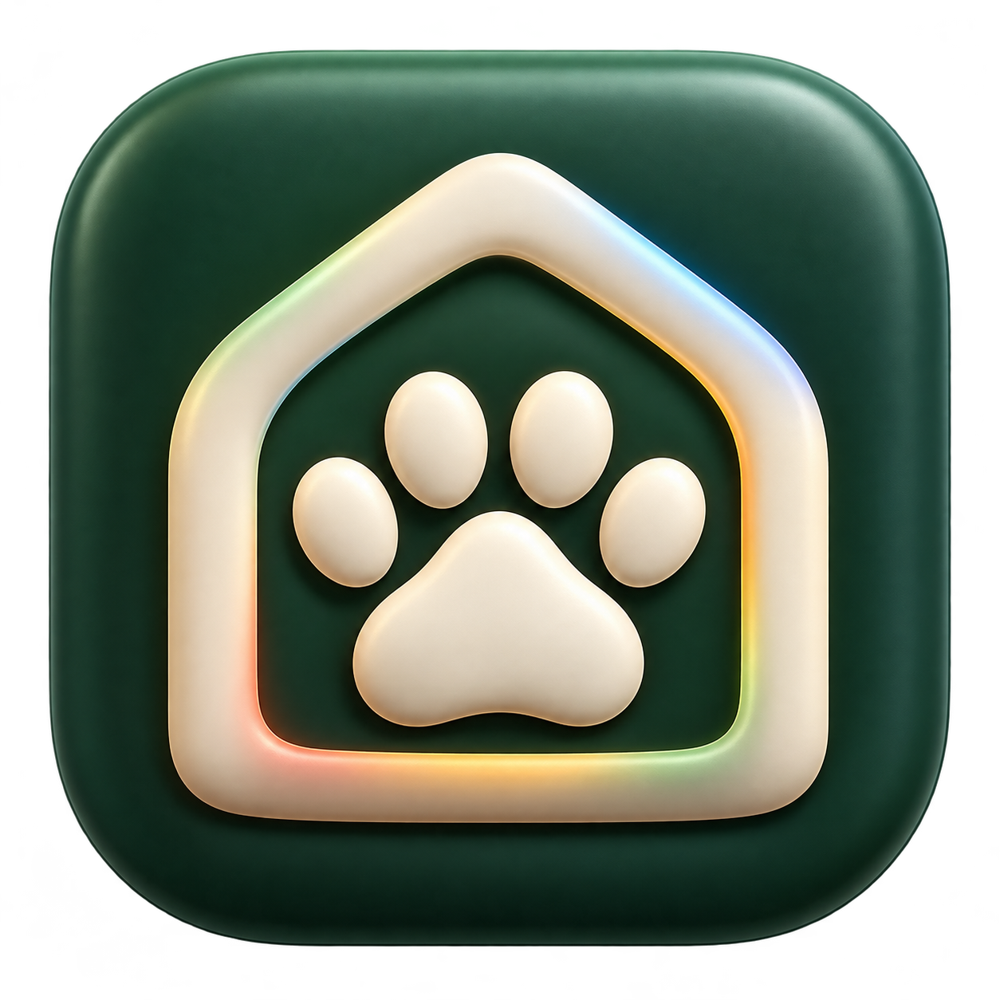
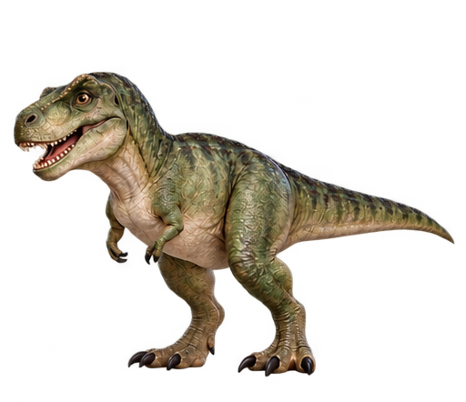
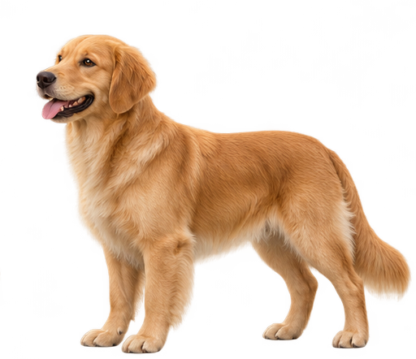
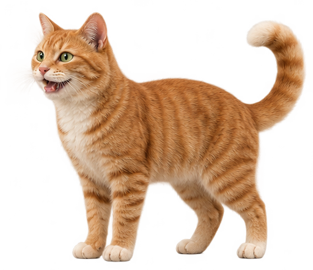
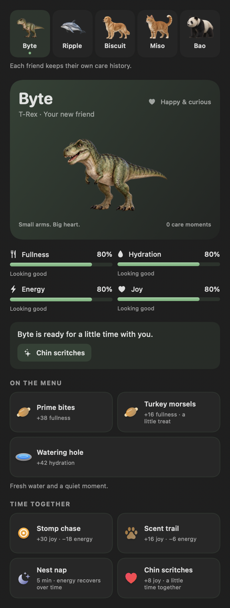
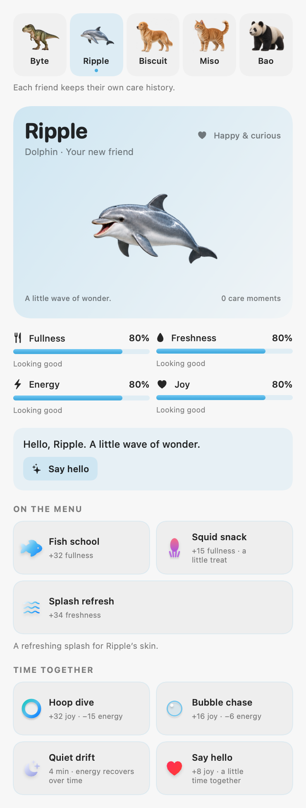
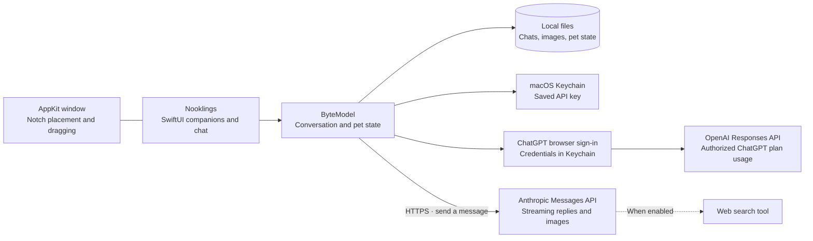

<div align="center">



<h1>Nooklings</h1>

**Little companions. A world of personality.**

Five lifelike friends below your Mac’s notch. Optional Claude or ChatGPT, one click away.

<br>


<br><br>

[Get started](#get-started) · [Features](#features) · [Meet the Nooklings](#meet-the-nooklings) · [Settings](#settings) · [Privacy & cost](#privacy-and-cost) · [Troubleshooting](#troubleshooting) · [Development](#development)

</div>

---

Nooklings is a native macOS companion app with five lifelike friends to choose from, each with their own food, hydration, play, and rest routines. They live just below the notch, react while thinking, and remember where you leave them. A compact Claude or ChatGPT panel handles everyday questions, images, and web research.

Click to chat. Hover to care. Drag to make yourself at home.

**The pet works without an AI connection.** For replies, use an eligible ChatGPT plan through browser sign-in, or connect your own Anthropic API key. Credentials stay in macOS Keychain. Nooklings is built with SwiftUI and AppKit, with no third-party runtime dependencies.

> **Source preview:** Nooklings is currently built from source. Bundles produced by this repository are unsigned. Automated macOS build, test, and bundle checks pass; real sign-in and UI behavior still need manual verification. See the [review and validation notes](docs/CODE_REVIEW.md#nooklings-update--october-18-2026) for the current evidence.

<a id="features"></a>
## ✨ What you get

### 🦖 A desktop companion with a personality

- **Five lifelike companions** with neutral, happy, thinking, eating, drinking, and sleeping expressions. Byte’s existing tricks, smiles, wiggles, and greetings remain, with distinct care movements for each animal.
- **A modern care dashboard** with fullness, hydration (freshness for Ripple), energy, joy, suggested actions, and recent moments. Each companion keeps separate needs, age, care history, and rest progress.
- **Species-specific care** with two foods, two play activities, water or splash refreshes, affection, and timed naps. Smooth props and quiet synthesized cues replace the pixel objects. Reduce Motion keeps care functional with static expressions.
- **Optional check-ins** and adjustable puns, from off to lots.
- **A home under the notch**, or wherever you drag them. Their pinned position is remembered; a right-click resets it.

### 🧠 Claude or ChatGPT, one click away

- **Continue with ChatGPT** uses OpenAI's documented sign-in flow for local apps. Eligible Plus and Pro users can authorize plan usage without an API key.
- **Account and model choices** keep ChatGPT registrations separate and load the selected account's available models.
- **Claude API access** remains available with an Anthropic key; subscription login requires prior Anthropic approval for a third-party product.

- **Streaming replies** in a compact panel, with Markdown formatting and copyable code blocks.
- **Image questions** by dragging an image onto your companion, pasting with ⌘V, or using the clipboard button. Attach a screenshot, diagram, or photo to your next message.
- **Optional web search** with source links beneath answers, capped at five tool uses per request.
- **Model and effort controls** in Settings; changes apply to your next message.
- **Stop reply** to cancel generation or a retry. Partial text stays visible with an interruption status.
- **A session usage estimate** for reported tokens and searches.

### 📚 Conversations you can come back to

- **Persistent chat history** and locally stored image attachments.
- **New chat** archives your current thread before clearing it.
- **Saved chats** lets you browse previews, reopen a conversation, or delete an archive.
- **Prompt saving and streaming checkpoints** preserve work before a request and about once a second while replies arrive.
- **Visible storage errors**: failed archiving keeps the live conversation available, and unreadable history is preserved in a recovery copy before replacement.

### 🍎 Built for the Mac

- **SwiftUI + AppKit**, with a transparent, borderless companion window and no Dock icon.
- **macOS Keychain** for API keys entered in the app.
- **Launch at login** for an installed app bundle.
- **No notch required**: Nooklings falls back to the top of the main display.

<a id="get-started"></a>
## 🚀 Get started

### 1. Check your Mac

| Requirement | Details |
| --- | --- |
| Operating system | **macOS 14 Sonoma or newer** |
| Build tools | **Swift 5.9+**, supplied by Xcode or Xcode Command Line Tools |
| AI chat | An **eligible ChatGPT plan** or **Anthropic API key**, and an internet connection |
| Pet and care | Works locally without an API key |

Check your toolchain with `swift --version`. If Apple's command-line tools are missing, run `xcode-select --install` and finish the installer before continuing.

### 2. Clone and run

The app is now **Nooklings**. The repository currently uses its original `byte` URL; the checkout below names your local folder `nooklings`.

```bash
git clone https://github.com/ronniekai999/byte.git nooklings
cd nooklings
swift run Nooklings
```

Your companion appears near the top of your display. **Click to open chat, or hover and choose Care to meet all five.** Choose **ChatGPT · your plan** and **Continue with ChatGPT**, then approve Nooklings in your browser. Nooklings loads your account's available models after connecting. You can also use the pet first, or choose **Claude · API key**, paste your key, and choose **Save**.

ChatGPT requests use your authorized plan allowance or available credits. **Manage usage** opens ChatGPT settings, where you can review usage and set Nooklings’ limits. This uses the supported local-app integration, not a Codex login or access to existing ChatGPT conversations. Paid or remotely hosted distribution needs OpenAI approval; see [OpenAI's plan-usage guide](https://developers.openai.com/siwc/token-sharing-open-source).

For Claude, create a key in the [Anthropic Console](https://console.anthropic.com/). API requests use your API billing or eligible credits. Anthropic's October 7, 2026 update adds monthly API credits to Max and Team plans, but its developer docs still require prior approval to offer subscription login in a third-party product. See [the subscription update](https://support.claude.com/en/articles/15036540-use-the-claude-agent-sdk-with-your-claude-plan) and [the developer requirement](https://code.claude.com/docs/en/agent-sdk/overview#get-started). Being a general companion app does not change that requirement.

### 3. Make it an app

From the repository directory:

```bash
./bundle.sh
open Nooklings.app
```

The script builds the release executable and assembles `Nooklings.app` with its icon, all companion artwork, and macOS bundle metadata. Move the app into **Applications** for everyday use, then enable **Launch at login** in Nooklings’ Settings if desired.

This is a locally built, **unsigned** bundle. If macOS asks for confirmation, use Finder's **Open** action and follow the system prompts. Developer ID signing and notarized distribution are on the [roadmap](#roadmap).

<details>
<summary><strong>Use an environment variable instead of saving a key</strong></summary>

An `ANTHROPIC_API_KEY` environment variable takes precedence over the key saved in Keychain. For a terminal-launched development session, enter it without putting the key in shell history:

```bash
read -r -s -p "Anthropic API key: " ANTHROPIC_API_KEY
printf '\n'
export ANTHROPIC_API_KEY
swift run Nooklings
unset ANTHROPIC_API_KEY
```

These commands use **Bash**; run `bash` first if your terminal uses another shell. A Finder-launched app does not automatically inherit this terminal variable. Use the in-app key form for an installed app.

</details>

<a id="meet-byte"></a>
<a id="meet-the-nooklings"></a>
## Meet the Nooklings

<table>
<tr>
<td align="center" width="20%"><br><strong>Byte</strong><br>T-Rex<br><em>Small arms. Big heart.</em></td>
<td align="center" width="20%"><br><strong>Ripple</strong><br>Dolphin<br><em>A little wave of wonder.</em></td>
<td align="center" width="20%"><br><strong>Biscuit</strong><br>Golden retriever<br><em>Your golden-hour best friend.</em></td>
<td align="center" width="20%"><br><strong>Miso</strong><br>Tabby cat<br><em>Curiosity, with a side of mischief.</em></td>
<td align="center" width="20%"><br><strong>Bao</strong><br>Giant panda<br><em>Slow mornings. Happy tumbles.</em></td>
</tr>
</table>

Choose a friend from **Care**, available on the hover bar or right-click menu. See the [companion guide](docs/COMPANIONS.md) for their care routines. Byte is selected on existing installations, and your original `pet.json` stays intact. Each friend’s needs continue to advance with elapsed time when you return to them.

| Companion | Food & treat | Hydration / refresh | Play & gentle activity | Rest |
| --- | --- | --- | --- | --- |
| **Byte · T-Rex** | Prime bites · turkey morsels | Watering hole | Stomp chase · scent trail | 5-minute nest nap |
| **Ripple · dolphin** | Fish school · squid snack | Splash refresh for skin freshness; fish also restores moisture | Hoop dive · bubble chase | 4-minute quiet drift |
| **Biscuit · dog** | Dinner bowl · crunchy biscuit | Refilled water bowl | Fetch · sniff safari | 5-minute cozy nap |
| **Miso · cat** | Salmon supper · chicken nibbles | Fresh drinking fountain | Feather pounce · sunbeam chase | 3-minute catnap |
| **Bao · panda** | Bamboo buffet · apple slices | Forest spring | Bamboo roll · leaf puzzle | 6-minute bamboo snooze |

Food and water replenish needs up to 100%; play uses energy. Hungry, thirsty, or exhausted friends ask for care before energetic games. Rest recovers energy over time, including while the app is closed; **Wake gently** keeps only the energy already recovered. These are playful virtual-pet routines. Care works locally and never requires AI credits.

<p align="center">


</p>

*Native macOS renders of the full care content. The app presents this inside a compact scrolling panel.*

The quick controls and dashboard run the same animations and award care once at the action’s payoff. Switching companions is paused during care or a streaming reply. The chat persona changes with your friend; the conversation and AI connection stay shared across the app.


| Action | What happens |
| --- | --- |
| **Click your companion** | Open or close chat |
| **Hover over your companion** | Reveal quick feed, water/splash, play, rest/wake, and Care controls |
| **Open Care** | Choose a companion; see needs, food choices, activities, rest progress, and recent care |
| **Drag your companion** | Move them and remember the new position |
| **Type, then Return** | Send a question |
| **Drop or paste an image** | Attach it to the next question |
| **Stop reply** | Cancel an active reply or retry |
| **New chat** | Archive the current thread and start fresh |
| **Saved chats** | Browse, reopen, or delete archived conversations |
| **Right-click your companion** | Open chat, perform tricks, manage care, reset position, sign out, or quit |

A few things to try:

- “Explain the error in this screenshot.” Paste an image, then ask.
- “Find the official documentation for this API.” Enable web search for source links.
- “Help me simplify this Swift function.” Paste code and copy the suggested result.
- Bring Bao a bamboo buffet, help Ripple splash, or take Biscuit on a sniff safari.

The companion window sits **below** the physical notch cutout. Dragging your companion lets you choose a different spot on your display.

<a id="settings"></a>
## ⚙️ Make Nooklings yours

Open chat and choose the **gear** in its header.

| Setting | Default | What it changes |
| --- | --- | --- |
| AI connection | Claude API for existing installations | Choose Claude API or your ChatGPT plan; manage saved connections |
| ChatGPT account | Last selected registration | Switch accounts/workspaces, add an account, reauthorize, or sign out |
| Web search | On | Allows the provider to search when the selected model/account supports it |
| Sound effects | On | Plays a quiet sound palette for each animal |
| Random check-ins | On | Lets your companion occasionally say hello or mention a need |
| Puns | Lots | Choose Off, Light, or Lots |
| Model | Sonnet 4.6 for Claude; first available catalog entry for ChatGPT | Selects the next request's model |
| Effort | High | Low, Medium, or High for supported Claude models; disabled for ChatGPT |
| Launch at login | Reflects macOS registration | Starts an installed Nooklings bundle when you sign in |

### Model choices

ChatGPT choices come from your account's live model catalog, preserving its ordering. Use **Refresh models** to retry a failed catalog request. Capabilities such as image input and web search depend on the chosen model and account policy; provider errors remain visible and do not silently switch billing.

The Claude picker contains these identifiers:

| Choice | API model ID | Request behavior |
| --- | --- | --- |
| Sonnet 4.6 | `claude-sonnet-4-6` | Image input, adaptive thinking, adjustable effort |
| Opus 4.8 | `claude-opus-4-8` | Configured for image input, adaptive thinking, adjustable effort |
| Haiku 4.5 | `claude-haiku-4-5-20251001` | Image input and standard generation; effort is disabled |

Model IDs and capabilities are configured in [AnthropicRequest.swift](Sources/Byte/AnthropicRequest.swift). **Live model availability has not been verified**, and the Opus identifier was retained from the original source. If a request reports an unavailable model, choose one your Anthropic account supports. Model discovery and a shared capability/pricing catalog are planned.

<a id="privacy-and-cost"></a>
## 🔐 Your data, connections, and usage

### Upgrading from Byte

Quit the old Byte app before opening **Nooklings.app**, then replace the old app in Applications. If you use Launch at login, turn it off in Byte before replacing the app and turn it on again in Nooklings afterward.

Your original Byte pet, conversations, images, settings, pinned position, and saved connections remain available. To preserve them, Nooklings retains `~/.config/byte`, the `com.ronnie.byte` bundle identifier, existing preference keys, and Keychain service names. Existing ChatGPT registrations may still appear as **Byte** in your account; new registrations use **Nooklings**. Internal Swift module and source paths also retain `Byte` for compatibility.

### What stays on your Mac

Nooklings stores conversations, pet state, and attachments under `~/.config/byte`:

```text
~/.config/byte/
├── history.json                 # Current conversation
├── pet.json                     # Byte’s original needs, age, rest, and care history
├── pet-{animal}.json            # Separate dolphin, dog, cat, and panda state
├── archives/
│   └── chat-<timestamp>-<UUID>.json
├── images/
│   └── <UUID>.jpg               # Resized image attachments
└── history-recovery-<UUID>.json  # Created when unreadable history is preserved
```

Settings, selected account, a stable opaque ChatGPT host ID, and pinned position use macOS preferences. API keys and ChatGPT account credentials use separate **Keychain** records, apart from conversation files. Chat and image files are local files; they are **not encrypted by Nooklings**. Back up the whole data directory to retain attachments alongside chats.

ChatGPT sign-in opens the system browser and briefly listens on `127.0.0.1` for its callback. Nooklings verifies the signed identity token, state, nonce, audience, issuer, and expiration before making the new account active. Returning sign-ins reuse that account's issued client ID and the installation's host ID. Tokens refresh automatically and are saved together in Keychain. Credential updates are coordinated across Nooklings processes. If Keychain rejects a save, Nooklings retains the replacement in memory and pauses plan requests until **Retry Keychain save** succeeds. Sign-out attempts remote revocation and clears local tokens; if revocation cannot be confirmed, Nooklings tells you to disconnect it in ChatGPT settings. Account registration metadata is retained for later sign-in.

Older `~/.config/byte/api_key` files are migrated to Keychain. The plaintext file is removed only after the Keychain write and read succeed; a failed migration retains the original and shows an error. The older `~/.config/finn` directory is migrated when a Byte directory does not already exist.

### What goes to your AI provider

When you send a question, Nooklings sends the thread's conversation context, its instructions, and attached images to the selected provider: the **Anthropic Messages API** or **OpenAI Responses API**. Switching providers sends subsequent requests, including the existing thread context, to the newly selected provider. AI replies require cloud access. With web search enabled, the provider can use its supported search tool.

ChatGPT requests use `store: false` and `stream: true`, resend local context, and only count a reply as complete after `response.completed`. Subscription usage limits can apply across apps or specifically to Nooklings. A limit pauses sending until you review **Manage usage** and choose **Try again**. Nooklings never silently falls back to paid Anthropic API calls.

Image attachment is explicit: drag, paste, or use the clipboard button. Nooklings does not automatically capture your screen.

### How the cost estimate works

For Claude API requests, the session meter uses reported input/output tokens and web searches, with approximate prices defined in the source. It includes known usage from failed attempts. Actual billing can differ because of cached-token pricing, disconnects, and provider price changes. ChatGPT displays reported session tokens without a dollar estimate; use **Manage usage** for plan and credit usage.

Long conversations resend more context, including images. Starting a new chat, choosing a lower-cost supported model, and turning off search when you do not need it can reduce usage. Check actual charges in your Anthropic account; the meter is an estimate.

Deleting an archive currently leaves image sidecars on disk. Automatic image cleanup, retention limits, and context summarization are planned.

<a id="troubleshooting"></a>
## 🩺 Troubleshooting

| Symptom | What to check |
| --- | --- |
| **Build tools are missing** | Run `xcode-select --install`, complete installation, and confirm `swift --version` reports 5.9+. Build on macOS 14 or newer. |
| **Nooklings has no Dock icon** | This is an accessory app. Look near the top of the display; right-click your companion for **Quit Nooklings**. |
| **My companion is in the wrong place** | Right-click them and choose **Reset position to notch**, then drag them to your preferred spot. |
| **Chat asks for a key after I saved one** | Check the selected AI connection, storage error banner, and Keychain access. For terminal runs, check whether `ANTHROPIC_API_KEY` overrides the saved key. |
| **ChatGPT sign-in or models fail** | Check the visible connection error and selected account. Retry **Continue with ChatGPT** or **Refresh models** in Settings. Plan/account eligibility and provider availability still apply. |
| **ChatGPT credentials couldn't be saved** | Unlock Keychain or restore Nooklings’ access, then choose **Retry Keychain save** in the connection form. Keep Nooklings open so the pending replacement can be saved. |
| **ChatGPT reports a usage limit** | Open **Manage usage** to review plan and Nooklings limits, then choose **Try again** when usage is available. |
| **A model request is rejected** | Check the key's API access and the model ID in Settings. Live availability of the bundled IDs, especially Opus, needs verification. |
| **A reply stalls or is interrupted** | Use **Stop reply** and send again when connectivity recovers. Partial replies remain visible with a status and are excluded from future assistant context. |
| **New chat or reopening reports a save error** | Check available disk space and access to `~/.config/byte`. Keep the live thread and recovery files until the storage problem is resolved. |
| **Launch at login does not work** | Use an installed `Nooklings.app` rather than `swift run`. Check **System Settings → General → Login Items** for approval or add the app there manually. |
| **Keychain asks for access after a rebuild** | Unsigned executable changes can trigger another access prompt. Stable code signing is a distribution goal. |

For a bug report, include your macOS version, Swift version, steps to reproduce, and the visible error. Remove API keys and private chat content before sharing logs or screenshots. [Open an issue](https://github.com/ronniekai999/byte/issues).

<a id="architecture"></a>
## 🏗️ How it works



SwiftPM builds one native executable. AppKit manages the companion window; SwiftUI renders the pet, chat, settings, and archives. The model handles pet simulation, persistence, request snapshots, streamed responses, cancellation, retries, and usage accounting.

<a id="development"></a>
## 🛠️ Development

Run the native checks **on a Mac**:

```bash
swift build
swift test
./bundle.sh
plutil -lint Nooklings.app/Contents/Info.plist
```

The [macOS workflow](.github/workflows/ci.yml) runs the same sequence. The **68-test suite** passes on macOS 14 with Swift 5.10. Companion regression tests cover legacy-save migration, independent care histories, species-specific needs, elapsed naps, cancellation and duplicate-action protection, corrupted-save preservation, bundled artwork, and light/dark native render checks. Coverage includes request options, usage, persistence, archives, key migration, images, interrupted streams, cancellation, citations, and link handling, plus ChatGPT callback validation, identity signatures/claims, account separation, coordinated token rotation, sign-out during refresh, failed-save recovery, catalog retry, complete loopback sign-in and expired-code recovery, plan limits, and request contracts. Tests use temporary directories, stubbed HTTP streams, and in-memory credential stores; they do not make live provider calls or use your real Keychain.

See the [passing native run](https://github.com/ronniekai999/byte/actions/runs/39100486937) and [readiness review](docs/CODE_REVIEW.md#readiness-review--october-10-2026) for the evidence and hands-on test steps. Live provider sign-in, real Keychain prompts, Login Items approval, and UI/audio behavior remain unverified.

### Source map

| File | Responsibility |
| --- | --- |
| [App.swift](Sources/Byte/App.swift) | App lifecycle, borderless window, placement, and dragging |
| [ByteModel.swift](Sources/Byte/ByteModel.swift) | Conversation state, persistence, archives, pet care, and streaming |
| [AnthropicRequest.swift](Sources/Byte/AnthropicRequest.swift) | Model-specific request options and cumulative usage |
| [APIKeyStore.swift](Sources/Byte/APIKeyStore.swift) | Keychain storage and the testable key-store interface |
| [ChatGPTAuth.swift](Sources/Byte/ChatGPTAuth.swift) | Browser authorization, verified identities, protected account records, token refresh and sign-out |
| [ChatGPTCredentialLock.swift](Sources/Byte/ChatGPTCredentialLock.swift) | Shared credential locking across Nooklings processes |
| [OAuthLoopbackListener.swift](Sources/Byte/OAuthLoopbackListener.swift) | Temporary local OAuth callback listener |
| [ChatGPTRequest.swift](Sources/Byte/ChatGPTRequest.swift) | Subscription request contract and Responses stream events |
| [ByteView.swift](Sources/Byte/ByteView.swift) | Pet interaction, chat, Markdown, settings, and archives |
| [ByteSprite.swift](Sources/Byte/ByteSprite.swift) · [Props.swift](Sources/Byte/Props.swift) | Cached lifelike expressions and smooth care objects |
| [Companion.swift](Sources/Byte/Companion.swift) · [PetCare.swift](Sources/Byte/PetCare.swift) | Species profiles and elapsed-time care simulation |
| [CareView.swift](Sources/Byte/CareView.swift) | Companion selection, needs, and care dashboard |
| [Quips.swift](Sources/Byte/Quips.swift) · [Sound.swift](Sources/Byte/Sound.swift) | Personality and synthesized audio |
| [WebLinks.swift](Sources/Byte/WebLinks.swift) | HTTP(S)-only generated link handling |

For contributions, keep changes focused, explain the user-visible behavior, and run the relevant macOS checks. Add regression coverage for changes to persistence or streaming, where failures can lose work or corrupt context. Real Keychain prompts, live provider access, visual behavior, and monitor changes also need manual Mac checks.

<a id="roadmap"></a>
## 🌱 What's next

The next priorities are:

1. **A configurable global shortcut** to open and focus chat across apps.
2. **Context and spending controls**, with thread limits and optional summaries.
3. **Verified model discovery**, shared capabilities, and current pricing.
4. **Signed, notarized distribution** with stable Keychain identity.
5. **Image cleanup and attachment recovery**, better display positioning, a resizable panel, and broader VoiceOver validation.

See the [full roadmap](ROADMAP.md) and [ranked review findings](docs/CODE_REVIEW.md#next-improvements) for scope and acceptance criteria.

---

<div align="center">

**A little nook. A friend for every mood.**

Built for the little moments between the big ones. 🐾

</div>
