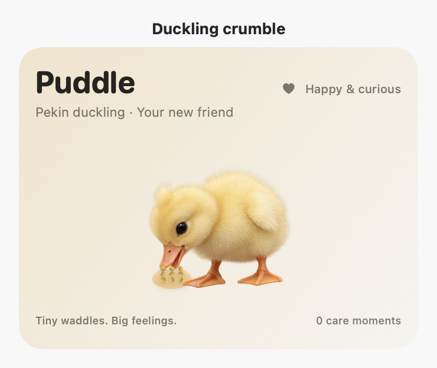
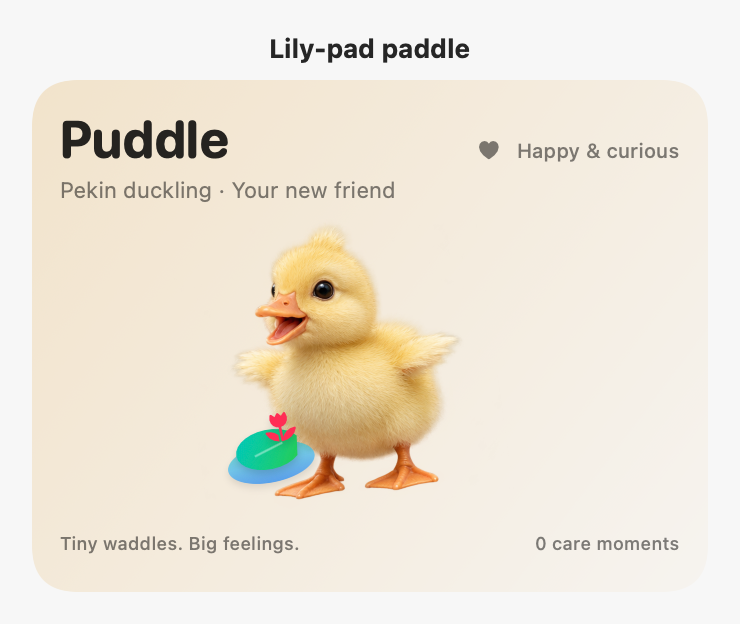
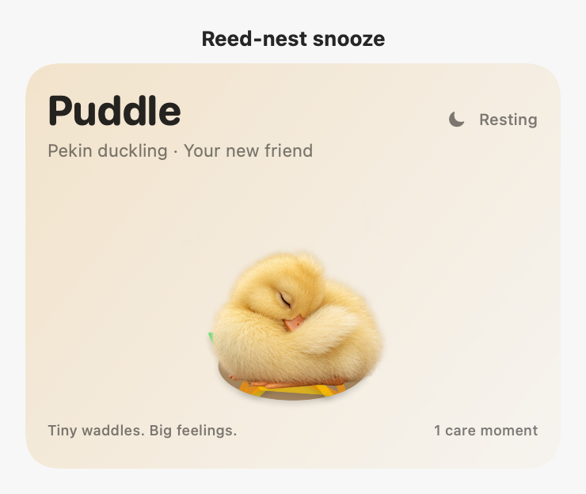

# Meet the Nooklings

[See all six portraits and the care dashboard](../README.md#meet-the-nooklings).

Open **Care** from the hover bar or the companion’s right-click menu. Choose Byte, Ripple, Biscuit, Miso, Bao, or Puddle in the two-row picker at the top. The selected companion is remembered on the next launch.

| Friend | Meals and treats | Refresh | Activities | Recovery |
| --- | --- | --- | --- | --- |
| Byte, T-Rex | Prime bites; turkey morsels | A watering hole | Stomp chase; scent trail; chin scritches | Five-minute nest nap |
| Ripple, dolphin | Fish school; squid snack | Skin freshness from splashing; fish also adds moisture | Hoop dives; bubble chase; a friendly hello | Four-minute quiet drift |
| Biscuit, golden retriever | Dinner bowl; crunchy biscuit | Refill the water bowl | Fetch; sniff safari; belly rub | Five-minute cozy nap |
| Miso, tabby cat | Salmon supper; chicken nibbles | A fresh running fountain | Feather pounce; sunbeam chase; chin rub | Three-minute catnap |
| Bao, giant panda | Bamboo buffet; apple slices | Cool forest spring | Bamboo roll; leaf puzzle; gentle pat | Six-minute bamboo snooze |
| Puddle, Pekin duckling | Duckling crumble; pea nibbles | Fresh-water bill dip and splash | Lily-pad paddle; duckweed hunt; cheek nuzzle | Four-minute reed-nest snooze |

The four meters show **satisfied needs**, so a high Fullness or Hydration value is good. Ripple uses Freshness in place of Hydration. Meals, snacks, replenishment, energy costs, recovery rates, and passive decay vary by species. Controls explain when a friend needs food, water, or rest before an activity.

Both the quick bar and the dashboard trigger the same animated actions. Each meal, game, or refresh is counted once when the interaction finishes. Closing the dashboard lets the scene finish beside the notch. Quitting before the payoff cancels that unfinished action. Reduce Motion uses a static expression and short feedback instead of the movement; care still completes.

Naps recover energy gradually. They continue while the app is closed, and **Wake gently** keeps the energy earned so far. Switching pets keeps each friend’s age, needs, rest schedule, and last five care moments. Byte still uses the original `~/.config/byte/pet.json`; the other companions use `pet-dolphin.json`, `pet-dog.json`, `pet-cat.json`, `pet-panda.json`, and `pet-duck.json`. An unreadable save is preserved and its error appears in Care.

The chat persona follows the selected animal. Conversation history, credentials, and settings remain shared by Nooklings. Selection is paused during a care action or streaming reply. Pet care uses no network calls or AI credits.

## Puddle’s little pond

Puddle is a fluffy yellow Pekin duckling: curious head tilts, tiny lifted wings, orange webbed feet, and a bill tucked into down at bedtime. The six expression frames are bundled locally. The duckling uses gentle idle waddles and curious greetings, with its own quiet synthesized peeps (controlled by **Sound effects**).

- **Duckling crumble** adds 29 fullness; **Pea nibbles** add 13.
- **Bill dip & splash** adds 35 hydration and 7 joy, with repeated sips and a bill rinse.
- **Lily-pad paddle** adds 29 joy, using 11 energy and 4 hydration, with a rocking paddle motion.
- **Duckweed hunt** adds 16 joy and 6 fullness, using 6 energy and 2 hydration. Puddle searches and pecks at floating leaves.
- **Reed-nest snooze** restores 12 energy per minute for four minutes. The sleeping duckling settles into a visible nest; rest continues after switching companions or closing the app.
- **Cheek nuzzle** adds 8 joy with a head lean and a tiny happy peep.

All gains cap at 100. Puddle’s food and water decline by 8.5 and 9.5 per hour; energy declines by 3.25 per hour while awake. These are virtual-pet mechanics. Reduce Motion keeps all care available with static expressions, and each completed action is saved once.

*Native macOS renders of Puddle’s eating, paddling, and sleeping scenes.*

## Artwork and verification

All six animals use bundled transparent artwork with six expressions: neutral, happy, thoughtful, eating, refreshing, and asleep. Existing tricks remain available, and each species has its own care props, movement sequence, and quiet sound palette. Companion artwork and the Nooklings app icon were generated for this update with OpenAI image generation. No runtime image service is required.

The macOS workflow builds the app, runs the regression suite, assembles the release bundle, verifies its resources and metadata, and exports light/dark renders of each full care dashboard as the `companion-previews` artifact. The artifact also includes each of Puddle’s eight care actions with and without Reduce Motion. The exported content omits the outer scroll container so all controls can be inspected at once.

Tests cover legacy decoding, independent saves, completed and interrupted actions, duplicate completion protection, sleep across relaunch, clock rollback, species differences, damaged-save preservation, all thirty-six expression assets, and native dashboard rendering. A hands-on Mac pass is still needed to judge live animation timing, audio, and interaction with the notch window.
